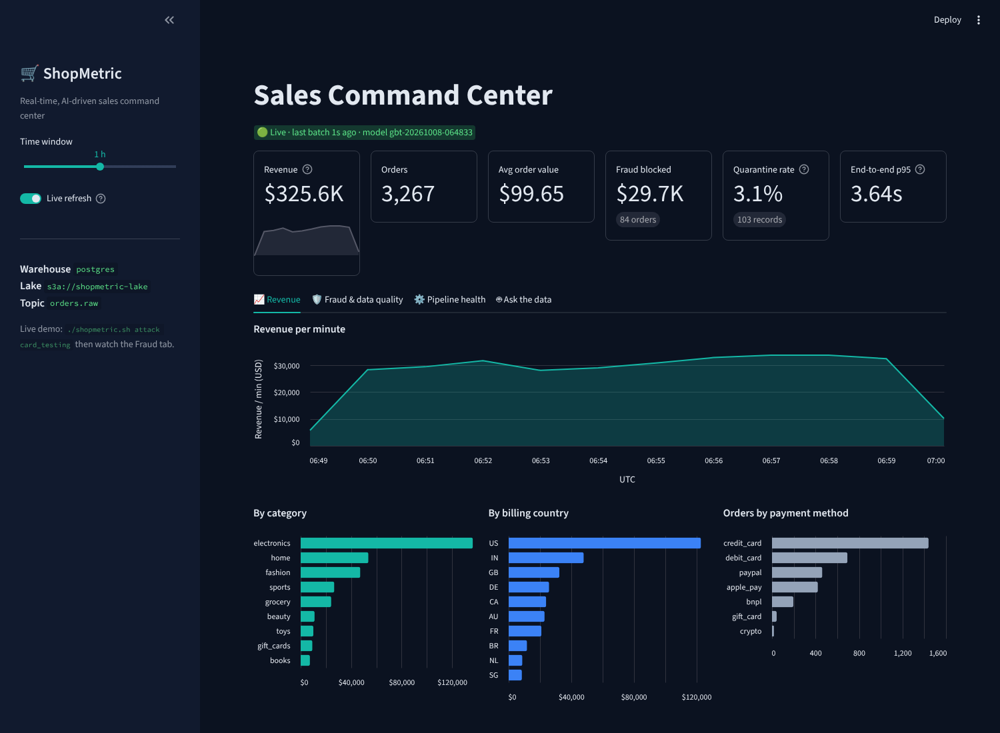
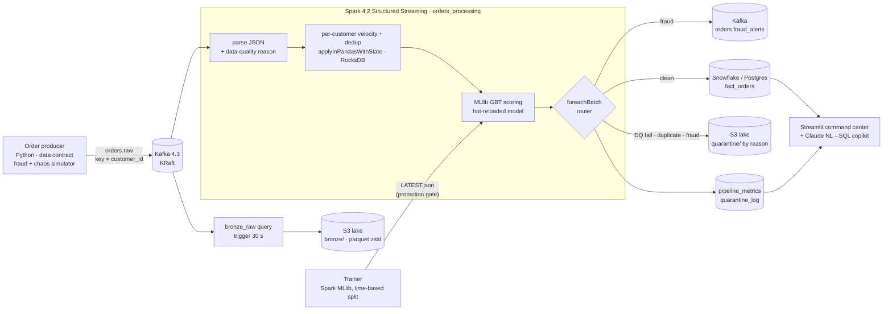
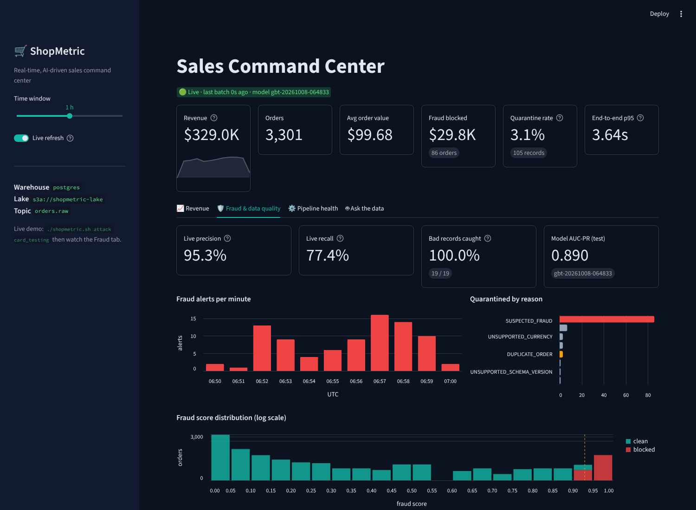
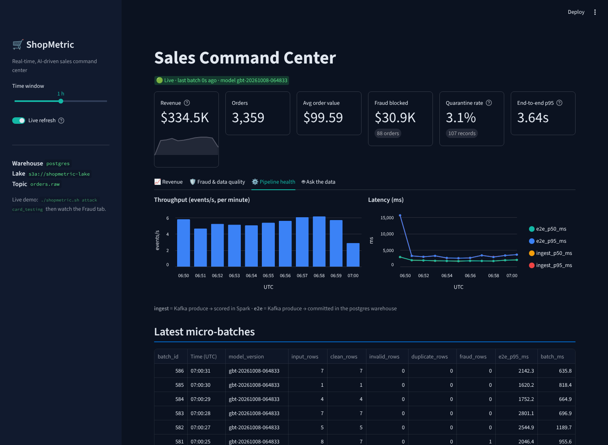

# ShopMetric — Real-Time AI-Driven Sales Command Center

[](https://github.com/YOUR_GITHUB_USER/shopmetric/actions/workflows/ci.yml)
   

A streaming e-commerce platform that ingests checkout events from **Kafka**, validates them against a
**data contract**, computes **stateful per-customer fraud features** in **Spark Structured Streaming**,
scores every order with an **MLlib** model, quarantines bad and fraudulent records to an **S3 lake**,
lands clean orders in **Snowflake**, and serves a live **Streamlit** command center with an
**LLM "ask the data" copilot**. One command starts it all, locally and for free.



---

## Contents
1. [What it does](#what-it-does)
2. [Architecture](#architecture)
3. [Quick start (local, free)](#quick-start-local-free)
4. [Build it yourself: phase-by-phase guide](#build-it-yourself-phase-by-phase-guide)
5. [Cloud mode: AWS S3 + Snowflake](#cloud-mode-aws-s3--snowflake)
6. [Commands](#commands)
7. [Project structure](#project-structure)
8. [Measured results](#measured-results)
9. [Putting it on your resume (honestly)](#putting-it-on-your-resume-honestly)
10. [Troubleshooting](#troubleshooting)
11. [Roadmap](#roadmap)

---

## What it does

| Capability | How |
|---|---|
| Real-time ingestion | Python producer → **Kafka 4.3 (KRaft, no ZooKeeper)**, keyed by `customer_id`, idempotent + `acks=all` |
| Data contracts | One **Pydantic** model → producer validation, Spark schema, exported **JSON Schema**; CI fails if they drift |
| Data quality | 7 rule types → reason codes (`MALFORMED_JSON`, `NON_POSITIVE_AMOUNT`, …); nothing is dropped silently |
| Stateful streaming features | Per-customer 10-minute order velocity + in-stream de-duplication with `applyInPandasWithState` on a **RocksDB** state store, with idle-state expiry |
| In-stream ML | **Spark MLlib GBT** fraud model, time-based evaluation, rules baseline, promotion gate, **hot-reload without restarting the stream** |
| Training/serving parity | The trainer reuses the stream's parsing + features; a test proves batch and streaming velocity are identical |
| Hybrid storage (cost) | Raw bronze + quarantined payloads → **S3** (zstd parquet, lifecycle tiers); only clean rows → **Snowflake** |
| Effectively-once | Idempotent warehouse upserts (`MERGE` / `ON CONFLICT`) + per-batch overwrite in the lake survive Spark replays |
| Real-time alerts | Suspected fraud published to a Kafka `orders.fraud_alerts` topic |
| Observability | Per-batch throughput, ingest & end-to-end latency, DQ catch rate and **live model precision/recall** |
| Dashboard | Streamlit fragments that refresh independently; revenue, fraud, data quality, pipeline health, model card |
| GenAI copilot | Natural language → SQL with **Claude**, guarded by **sqlglot** (read-only, allow-listed tables, row caps) and a read-only DB role |
| One-command ops | `./shopmetric.sh up / down / attack / bench / report / train` |
| CI/CD | GitHub Actions: lint, unit + Spark + Postgres tests, compose/shell checks, **full Docker end-to-end smoke test** |

## Architecture



Two independent streaming queries read the same topic, each with its own checkpoint:
- **bronze_raw** writes every message, untouched, to the lake every 30 s (few, large files = cheap storage and scans; full replay is always possible).
- **orders_processing** does the real work every second and fans out each micro-batch:
  alerts first (most urgent) → clean facts to the warehouse → quarantine to the lake → metrics.

**Three ways to run it, same code** (switching is a `.env` change, not a code change):

| Mode | For | What runs |
|---|---|---|
| **laptop** (`.env.laptop`) | 8 GB RAM machines, ~3 GB for Docker | Kafka, Spark, MLlib, Postgres, dashboard. The lake is a local folder with the same parquet layout as S3. |
| **full** (`.env.example`) | 16 GB+ machines or GitHub Codespaces | Laptop mode plus SeaweedFS as a local S3 server and Kafka UI. MinIO stopped publishing community images in 2025, hence SeaweedFS. |
| **cloud** | Showing the real thing | Kafka and Spark in Docker, the lake on **AWS S3**, the warehouse on **Snowflake** |

`./shopmetric.sh up` picks laptop or full mode from how much memory Docker has.

## Quick start (local, free)

**You need:** Docker (about 4 GB of RAM for laptop mode, 8 GB for full mode). On Windows, also WSL 2 +
Ubuntu; run every command from the Ubuntu terminal. Java, Spark, Kafka, Python and Postgres all run
inside Docker. **Follow [docs/SETUP.md](docs/SETUP.md)**, which has exact commands for 8 GB Windows
laptops (Docker Engine in WSL, no Docker Desktop), 16 GB machines, Macs and GitHub Codespaces.

```bash
git clone https://github.com/YOUR_GITHUB_USER/shopmetric.git && cd shopmetric
./shopmetric.sh up
```

The first run takes 10–25 minutes depending on the machine. It builds two images, downloads the Spark
Kafka/S3 connectors and trains the fraud model on 250k simulated orders. Later runs start in about a
minute. Then:

| Open | URL |
|---|---|
| Command center | http://localhost:8501 |
| Spark UI (streaming queries, state store) | http://localhost:4040 |
| Kafka UI (full mode) / `./shopmetric.sh topics` (laptop mode) | http://localhost:8080 |

Try the live demo:

```bash
./shopmetric.sh attack card_testing 3     # a card-testing attack; watch the Fraud tab light up
./shopmetric.sh train                     # retrain; the stream picks up the new model
./shopmetric.sh bench                     # 3-minute load test (200/s full, 50/s laptop), then a report
./shopmetric.sh lake                      # what landed in the data lake
./shopmetric.sh report                    # measured numbers for your resume
./shopmetric.sh down                      # stop (data kept)
```

Optional AI copilot: put an Anthropic API key in `.env` (`ANTHROPIC_API_KEY=...`) and run
`./shopmetric.sh up` again. The **Ask the data** tab then answers questions like
*"Which 5 countries had the most suspected fraud today, and how much money was blocked?"*

## Build it yourself: phase-by-phase guide

The repository is complete, but you will learn far more (and interview far better) if you rebuild it
in this order, reading each file as you go. Every phase ends with a check you can see.

| Phase | Goal | Files | Done when |
|---|---|---|---|
| 0. Setup | Docker, Python 3.12 venv (`make venv`), Java 21 for local Spark tests | `pyproject.toml`, `requirements/` | `make test` passes |
| 1. Events + contract | Model a checkout event; simulate legit traffic, 3 fraud patterns and 8 data faults | `contract.py`, `generator.py`, `producer.py` | Messages visible in Kafka UI or `./shopmetric.sh topics`, keyed by customer |
| 2. Kafka + bronze | KRaft broker, topics, raw copy of every message to the lake | `docker-compose.yml`, `streaming_job.py` (`start_bronze`) | Parquet files under `bronze/orders/ingest_date=…` |
| 3. Data quality | Parse against the contract, one reason code per bad record, quarantine with raw payload | `quality.py`, `transforms.py`, `sinks.py` (`LakeWriter`) | `tests/test_quality.py` green; quarantine folders per reason |
| 4. Stateful features | 10-minute per-customer velocity + dedup, state in RocksDB, idle expiry | `features.py` | `tests/test_features.py` parity test green |
| 5. Fraud model | GBT with class weights, time-based split, threshold tuning, rules baseline, promotion gate | `train_model.py`, `model.py` | `models/fraud/versions/*/metadata.json` shows the model beats the baseline |
| 6. Warehouse | Idempotent upserts, metrics table, read-only role | `warehouse.py`, `init_infra.py` | Replaying the stream does not duplicate rows (`tests/test_pipeline_e2e.py`) |
| 7. Dashboard | KPIs, fraud monitor, pipeline health, model card | `dashboard/app.py`, `dashboard_queries.py` | Live badge is green; attack shows up within seconds |
| 8. Ops + CI | One-command lifecycle, GitHub Actions with Docker smoke test | `shopmetric.sh`, `.github/workflows/ci.yml` | Green CI badge on your GitHub repo |
| 9. Cloud | AWS S3 + Snowflake with key-pair auth and cost guard rails | `infra/`, `.env` | Rows in `SHOPMETRIC.ANALYTICS.FACT_ORDERS` in Snowsight |
| 10. GenAI | NL→SQL copilot with layered guardrails | `copilot.py` | `tests/test_copilot_guardrails.py` green; Ask tab answers |

A realistic pace is 2–3 weeks part-time. Commit after every phase — a clean commit history is part
of what reviewers look at.

**Publish it** (create an empty `shopmetric` repo on GitHub first, then replace `YOUR_GITHUB_USER`
here and in the badge at the top of this file):
```bash
git init -b main && git add . && git commit -m "ShopMetric: real-time sales command center"
git remote add origin https://github.com/YOUR_GITHUB_USER/shopmetric.git && git push -u origin main
```
The CI workflow runs on every push; a green badge plus screenshots is what makes a reviewer click.

## Cloud mode: AWS S3 + Snowflake

Kafka and Spark keep running in Docker; the lake moves to S3 and the warehouse to Snowflake.

**A. AWS S3 (a few cents for this project)**
```bash
export BUCKET=shopmetric-lake-<your-initials>-<random-digits>    # must be globally unique
aws s3 mb s3://$BUCKET --region us-east-1
aws s3api put-bucket-lifecycle-configuration --bucket $BUCKET --lifecycle-configuration file://infra/aws/lifecycle.json
```
Create an IAM user (or role) with `infra/aws/iam-policy.json` (replace `YOUR_BUCKET_NAME`) and an access key.
The lifecycle rules move bronze data to cheaper tiers after 30/90 days and expire quarantine after 180.

**B. Snowflake (30-day free trial)**
```bash
openssl genrsa 2048 | openssl pkcs8 -topk8 -inform PEM -out secrets/snowflake_rsa_key.p8 -nocrypt
openssl rsa -in secrets/snowflake_rsa_key.p8 -pubout -out secrets/snowflake_rsa_key.pub
```
Open `infra/snowflake/setup.sql` in a Snowsight worksheet, paste the public key body (without the
BEGIN/END lines) in place of `<PUBLIC_KEY>`, and run it as `ACCOUNTADMIN`. It creates an XS warehouse
that auto-suspends after 60 s, a resource monitor that suspends it at 20 credits, writer/reader roles,
and a `TYPE = SERVICE` user that authenticates with the key — Snowflake has been blocking password
sign-in for service users through 2026, so key-pair auth is the supported option.

**C. Switch `.env` to cloud** — uncomment the `CLOUD MODE` block at the bottom of `.env`, fill in the
bucket, AWS keys and `SNOWFLAKE_ACCOUNT` (`SELECT CURRENT_ORGANIZATION_NAME() || '-' || CURRENT_ACCOUNT_NAME();`), then:
```bash
./shopmetric.sh up
```
Check Snowsight: `SELECT COUNT(*) FROM SHOPMETRIC.ANALYTICS.FACT_ORDERS;`

**Cost hygiene:** run `./shopmetric.sh down` when you are done (the warehouse then suspends), keep
`DASHBOARD_REFRESH_S=30` in cloud mode, and keep the resource monitor.

## Commands

| Command | What it does |
|---|---|
| `./shopmetric.sh up` | Build images, train the model if missing, start everything, wait until healthy, print URLs and elapsed time |
| `./shopmetric.sh down` | Stop all containers, keep data |
| `./shopmetric.sh reset [--all]` | Stop and wipe Kafka, lake, warehouse and checkpoints (`--all` also deletes models) |
| `./shopmetric.sh status` | Container status, memory per container, latest micro-batch log lines |
| `./shopmetric.sh logs [service]` | Follow logs (default `spark-stream`) |
| `./shopmetric.sh train [--orders N ...]` | Retrain; promoted models are hot-swapped into the running stream (laptop mode pauses the stream while training) |
| `./shopmetric.sh attack <scenario> [count]` | Inject `card_testing`, `account_takeover` or `synthetic_identity` in real time |
| `./shopmetric.sh bench [rate] [minutes]` | Load test, then a measured report |
| `./shopmetric.sh report [minutes]` | Throughput, latency, DQ catch rate, live precision/recall + resume phrasing |
| `./shopmetric.sh topics` | Kafka topics, message counts per partition, sample fraud alerts |
| `./shopmetric.sh lake` | Folders, sizes and parquet files written to the lake |
| `./shopmetric.sh mode laptop\|full` | Switch settings preset (keeps your API key; old `.env` saved as `.env.bak`) |
| `make test` / `make lint` | Local tests (needs `make venv` and Java 17+) |

## Project structure

```
shopmetric/
├── shopmetric.sh               one-command orchestration (up/down/attack/bench/report/train/mode)
├── docker-compose.yml          Kafka (KRaft), Kafka UI, SeaweedFS, Postgres, Spark, producer, dashboard
├── .env.example / .env.laptop  full-mode and 8 GB-laptop presets (copied to .env)
├── .devcontainer/              GitHub Codespaces config (4-core / 16 GB, Docker-in-Docker)
├── docker/                     spark.Dockerfile (JDK 21 + PySpark 4.2 + pre-fetched connectors), app.Dockerfile
├── src/shopmetric/
│   ├── contract.py             data contract (Pydantic) + Spark schema + JSON Schema export
│   ├── generator.py            order simulator: legit traffic, 3 fraud scenarios, 8 data faults
│   ├── producer.py             Kafka producer (idempotent, keyed, headers, attack mode)
│   ├── quality.py              data-quality rules -> reason codes
│   ├── transforms.py           Kafka normalisation + parsing (shared by stream, trainer, tests)
│   ├── features.py             stateless features + batch/stream velocity (one definition, two paths)
│   ├── streaming_job.py        the two streaming queries
│   ├── sinks.py                foreachBatch router: alerts, warehouse, lake, metrics
│   ├── model.py                hot-reloadable model provider + rules baseline
│   ├── train_model.py          MLlib GBT training, evaluation, promotion gate
│   ├── warehouse.py            Snowflake + Postgres sinks (idempotent upserts, SQL transpilation)
│   ├── copilot.py              Claude NL->SQL with sqlglot guardrails
│   ├── dashboard_queries.py    all dashboard SQL (tested on Postgres, transpiled to Snowflake)
│   ├── report.py               measured, resume-ready run report
│   ├── init_infra.py           idempotent bootstrap (bucket, tables, read-only role)
│   ├── spark_session.py        Spark config: RocksDB state, S3A, zstd
│   └── config.py               12-factor settings from environment
├── dashboard/app.py            Streamlit command center
├── contracts/                  exported JSON Schema of the event contract
├── infra/                      AWS IAM policy + lifecycle rules, Snowflake setup SQL
├── tests/                      contract, generator, DQ, feature parity, guardrails, Spark+Postgres e2e
├── scripts/ci_smoke.sh         full Docker end-to-end test used by CI
├── docs/SETUP.md               step-by-step install + run guide (8 GB Windows, 16 GB, Mac, Codespaces)
└── docs/interview-guide.md     how to demo it and answer the deep questions
```

## Measured results

Fraud model (seed 42, 250k simulated orders at 5 orders/s, time-based split, metrics on the most recent 15%):

| | AUC-PR | Precision | Recall | F1 | False-positive rate |
|---|---|---|---|---|---|
| **GBT model** | **0.89** | **0.81** | **0.82** | **0.82** | **0.49%** |
| Rules baseline | 0.51 | 0.49 | 0.59 | 0.53 | 1.60% |

Recall by scenario: synthetic identity 0.96, account takeover 0.83, card testing 0.80. Card testing is
the hardest on purpose: each order is a normal-looking small basket, so the first one or two orders of
a burst are indistinguishable from a real shopper — the model catches the burst once the per-customer
velocity feature climbs.

A 10-minute live run of the same streaming graph (5 orders/s, laptop-class CPU, a file source standing
in for Kafka, Postgres as the warehouse, one injected card-testing attack) measured:

| Metric | Value |
|---|---|
| End-to-end latency (produce → committed in warehouse) | 1.75 s median · 2.7 s p95 |
| Micro-batch duration | 0.74 s median |
| Injected bad records quarantined | 15 / 15 (100%) |
| Live fraud precision / recall | 92.6% / 80.0% |

**Laptop mode** (2 CPU cores, 768 MB Spark heap, 2-second trigger) measured over a 4-minute run:
1.4 GB for the Spark stream, 2.0 s median / 3.4 s p95 end-to-end, 6/6 bad records quarantined, and 91%
live precision / 83% recall.

**Your numbers will differ** — run `./shopmetric.sh bench` and `./shopmetric.sh report` on your
machine and quote those.




## Putting it on your resume (honestly)

Only claim what `./shopmetric.sh report` measured, and say under what conditions. A few of the
common phrasings for this kind of project do not survive an interviewer's follow-up:

- *"Sub-second ingestion"* — Spark micro-batches plus a warehouse commit usually land at 1–4 s end-to-end on a laptop. Quote the measured p95 instead.
- *"Prevented 100% of anomalies"* — no fraud model catches everything. What you **can** say is that 100% of contract-violating records were quarantined (it is measured against injected faults), plus the model's precision/recall.
- *"Reduced deployment time by 90%"* — give the baseline: N manual steps / X minutes → one command / Y seconds (`up` prints its own elapsed time).

Template bullets (fill the brackets from your report):

> **ShopMetric — Real-Time AI-Driven Sales Command Center** | *Kafka (KRaft), PySpark 4 Structured Streaming, Spark MLlib, AWS S3, Snowflake, Streamlit, Docker, GitHub Actions*
> - Built a real-time pipeline on Kafka and Spark Structured Streaming processing **[X]K events/day** at **[p95] s** end-to-end latency, with idempotent Snowflake MERGE upserts for effectively-once results across replays.
> - Engineered stateful per-customer velocity features (`applyInPandasWithState`, RocksDB) and an in-stream MLlib GBT fraud model (**AUC-PR [0.89]**, **[81]% precision / [82]% recall** vs a rules baseline at **[49]% / [59]%**) with hot-swappable model versions.
> - Enforced a versioned data contract and 7 data-quality rules, quarantining **100%** of injected malformed, invalid and duplicate records to S3 with reason codes while loading only clean records to Snowflake to cut warehouse compute.
> - Delivered a live Streamlit command center with a guard-railed Claude NL-to-SQL copilot, and automated the stack with a one-command Bash/Docker workflow and CI that runs a full end-to-end smoke test.

For the walkthrough, likely questions and honest limitations, read [docs/interview-guide.md](docs/interview-guide.md).

## Troubleshooting

| Symptom | Fix |
|---|---|
| Containers exit with code 137 / laptop very slow | Out of memory: `./shopmetric.sh mode laptop`, then `reset` + `up`; see [SETUP.md](docs/SETUP.md) path A |
| `bind: address already in use` | Another app uses 8501/8080/4040/5433/9094/8333 — change the left side of `ports:` in `docker-compose.yml` |
| `/usr/bin/env: 'bash\r'` on Windows | Line endings: `git config --global core.autocrlf false`, re-clone, or `sed -i 's/\r$//' shopmetric.sh scripts/*.sh` |
| `Permission denied: ./shopmetric.sh` | `chmod +x shopmetric.sh scripts/*.sh` (some unzip tools drop the executable bit) |
| First `up` is slow | Expected once: the Spark image pre-downloads the Kafka and S3A connectors (the AWS SDK bundle is large) |
| Dashboard says *Stalled* | `./shopmetric.sh logs spark-stream`; then `./shopmetric.sh status` |
| Want a clean slate | `./shopmetric.sh reset` (add `--all` to retrain the model too) |
| Snowflake `JWT token is invalid` | Account identifier must be `orgname-accountname`; check `DESC USER SHOPMETRIC_SVC` shows `RSA_PUBLIC_KEY_FP` |
| S3 `403` in cloud mode | Bucket name in `LAKE_URI` and in the IAM policy must match; region must match `AWS_REGION` |

## Roadmap

Natural next steps, each a resume line of its own:
- **Apache Airflow 3** DAG: nightly retrain → evaluate → promote, plus data-quality checks on the warehouse.
- **Apache Iceberg** tables on S3 (bronze/silver) queried from Snowflake as external Iceberg tables.
- **Snowpipe Streaming** for lower-latency warehouse ingestion than micro-batch MERGE.
- **dbt** gold marts (daily revenue, cohort retention) on top of `fact_orders`.
- **Terraform** for the S3 bucket, IAM and Snowflake objects; **MLflow** for experiment tracking and a model registry.
- Managed Kafka (Amazon MSK / Confluent Cloud) and Spark on Kubernetes or Databricks.

## License

MIT
